🌐 **Idioma / Language:** [Español](README.md) | **English**

<p align="center">
  
</p>

# ⚡ Center ROG Ally / Ally X

**Center ROG Ally / Ally X** is a native power management, thermal fan curve, and RGB lighting control center built specifically for the **ASUS ROG Ally** and **ROG Ally X** handhelds on **KDE Plasma 6** desktop environments (such as CachyOS, Bazzite, or Arch Linux) and **Steam Gaming Mode** (Gamescope).

The project delivers a clean, minimalist interface with zero heavy background daemons, communicating directly with Linux kernel interfaces (`asus-armoury`, `asus_custom_fan_curve`, and `hidraw` HID devices).

---

## 📸 Screenshots

### 🎮 Gaming Mode (Decky Loader Plugin)

#### ⚡ Power & TDP

| Power Profiles (13W / 17W / 30W) | Manual TDP Limit, Boost & Battery Care |
| :---: | :---: |
| 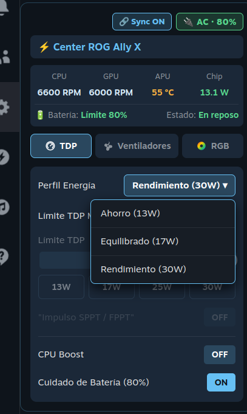 |  |

#### 🌀 Fan Control

| Mode Selector | Automatic (BIOS) |
| :---: | :---: |
| 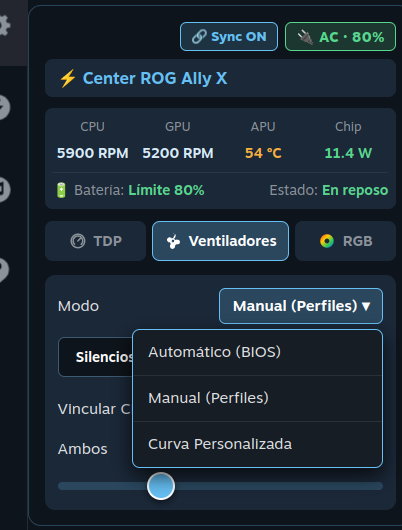 | 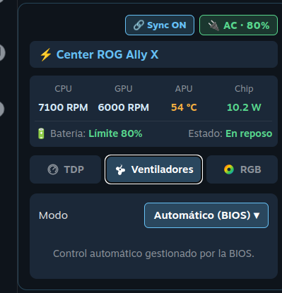 |

| Linked Manual (CPU + GPU) | Independent Manual (CPU / GPU) |
| :---: | :---: |
| 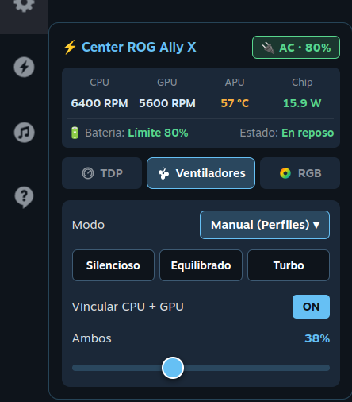 | 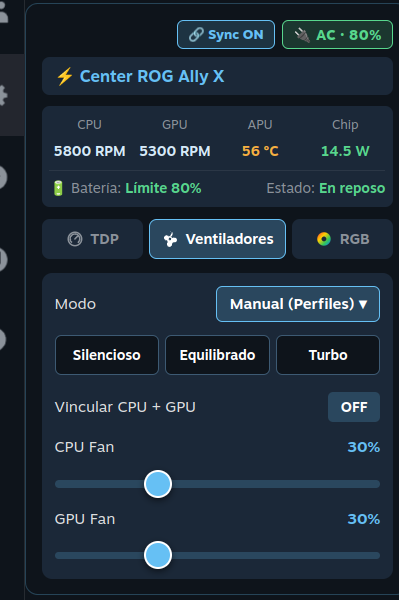 |

| Custom Curve (Cascade Mode) | Custom Curve (All Together) |
| :---: | :---: |
| 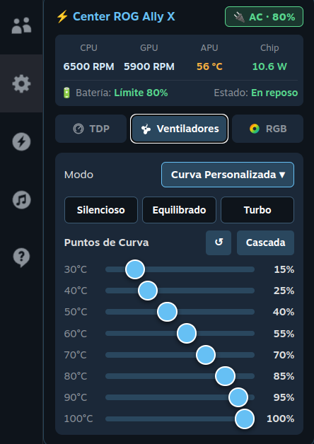 | 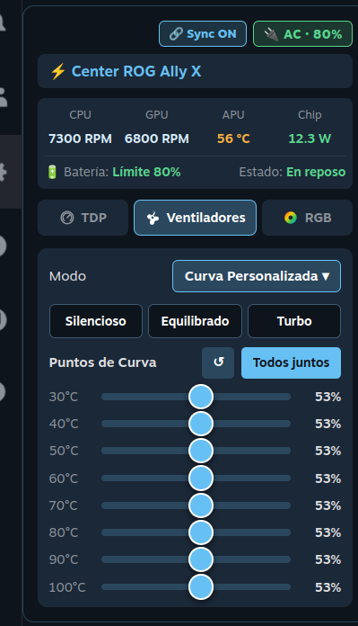 |

#### 🌈 Joystick RGB Lighting

| Static Color & Brightness | Dynamic Effects | Smart Sensors |
| :---: | :---: | :---: |
|  |  | 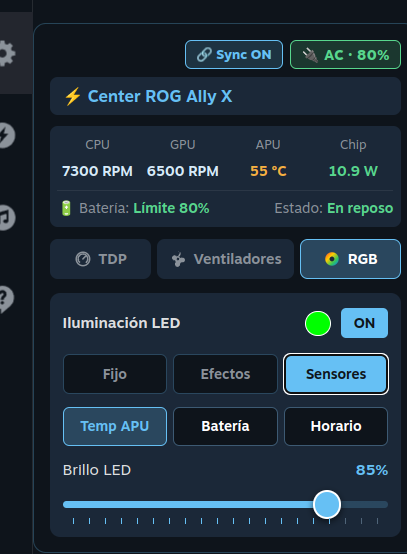 |

---

### 🖥️ Desktop Mode (KDE Plasma 6 Widget)

#### ⚡ Power & TDP

| Preset Profiles | Manual Tuning (4W – 30W) |
| :---: | :---: |
| 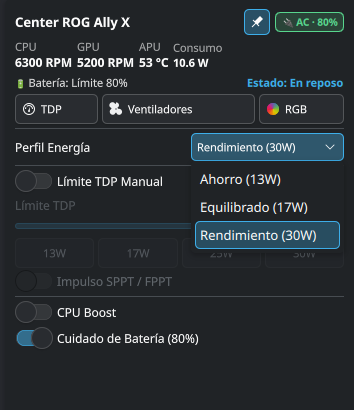 | 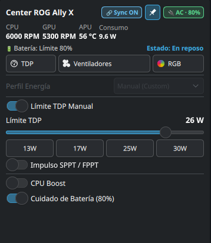 |

#### 🌀 Fan Control

| Automatic (BIOS) | Linked Manual | Independent Manual |
| :---: | :---: | :---: |
| 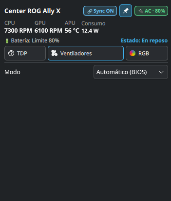 |  |  |

| Interactive Graph Curve (8 Points) | Sliders View (30°C – 100°C) |
| :---: | :---: |
| 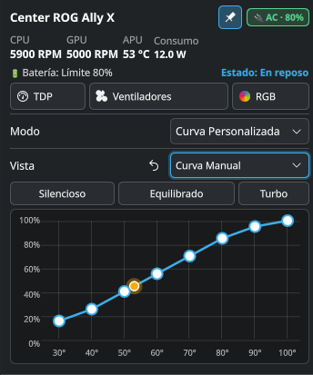 |  |

#### 🌈 RGB Lighting & R/G/B Sliders

| RGB Mode Selector | Static Color + R/G/B Sliders | Breathing Effect |
| :---: | :---: | :---: |
| 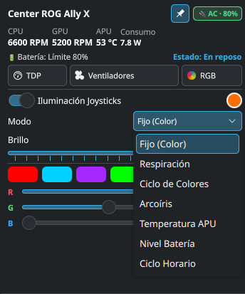 |  | 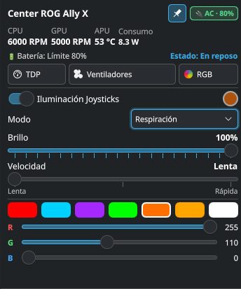 |

| Color Cycle | APU Temperature Sensor | Lighting Off |
| :---: | :---: | :---: |
| 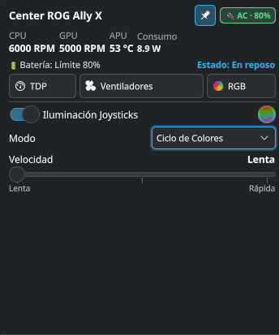 | 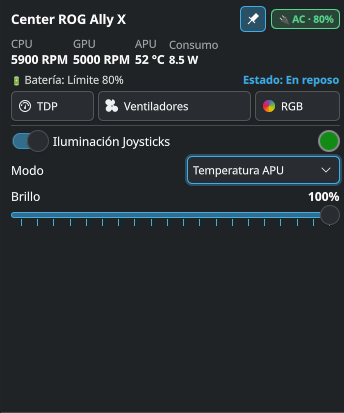 | 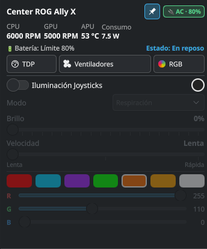 |

---

## ✨ Key Features

* **⚡ Real-Time Power & TDP Control:**
  * Quick system power profiles: **Silent**, **Balanced**, and **Performance**.
  * Instant wattage presets (**13W**, **17W**, **25W**, **30W** / **35W** on Ally X).
  * Independent fine-grained tuning for **SPL** (sustained), **SPPT** (2-minute boost), and **FPPT** (10-second boost).
  * Direct toggles for **CPU Turbo Boost** and the **80% battery charge limit**.
* **🌀 Thermal & Fan Management:**
  * **Auto Mode:** Delegates fan control to ASUS firmware.
  * **Manual Mode:** Fixed fan speed from 25% to 100%, with linked or independent **CPU** and **GPU** fan control (persisted across reboots and sleep/wake cycles).
  * **8-Point Custom Curve:** Interactive temperature (°C) vs. speed (%) editor with built-in presets (*Silent*, *Balanced*, *Turbo*).
* **🌈 Joystick RGB Lighting:**
  * Direct hardware control via raw HID packets (`/dev/hidraw*`).
  * Native hardware effects: **Static**, **Breathing**, **Cycle**, **Rainbow**, and **Pulse**.
  * Quick color presets and adjustable brightness slider.
* **🕹️ Native Gaming Mode Integration (No Decky Loader Required):**
  * Automatically integrates as a native tab inside Steam's **Quick Access Menu (QAM / `···` button)** in *Gaming Mode* via CEF injection, displaying real-time telemetry (CPU, GPU, battery, wattage, and temperatures) without relying on Decky Loader.
* **🎮 100% Native Controller Navigation in Gaming Mode:**
  * Full panel control without touch or mouse: **D-Pad / Left Stick (`↑`/`↓`)** to move across sections, **`A`** to enter a section and apply settings instantly, **`←`/`→`** to adjust sliders and presets, and **`B`** to exit each section or close the menu cleanly without conflicting with Steam.
* **🛡️ Automatic Persistence & Smart Profile Guard:**
  * Saves your settings to `/etc/ally-center.json` and automatically restores them on boot or resume from sleep via `systemd` services.
  * A smart background watcher prevents the OS from overwriting your custom TDP or power profile when plugging/unplugging the charger.
* **🌍 Multi-Language Support:** Interface automatically localized in **English** and **Spanish** based on your session locale.
---

## 🏗️ Project Architecture

1. **Privileged Backend (`ally_center.py`):** Python script that interfaces directly with `/sys/class/firmware-attributes/asus-armoury/` (TDP and power profiles), `asus_custom_fan_curve` (thermal curves), and raw HID packets via `/dev/hidraw*` for RGB lighting (`0x1B4C` / `0x1ABE`). Manages persistence in `/etc/ally-center.json` and runs passwordless via a `sudoers` rule.
2. **Desktop Interface (`main.qml`):** Native plasmoid built for **KDE Plasma 6** (Kirigami / PlasmaComponents3), lightweight and adaptive to your system color scheme.
3. **Gaming Mode Bridge (`ally_steam_bridge.py`):** Lightweight user service (`systemd --user`) connecting via WebSocket to Steam's local debugging port (`127.0.0.1:8080`) to inject the native QAM tab and handle controller navigation.

> For deeper technical details on `sysfs` paths, HID protocols, and service flows, see [ARQUITECTURA.md](ARQUITECTURA.md).

---

## 💻 Compatibility & Requirements

* **Supported Hardware:**
  * ✅ **ASUS ROG Ally X (`RC72LA`)** — *Full support.*
  * ✅ **ASUS ROG Ally (`RC71L` — Ryzen Z1 / Z1 Extreme)** — *Full support with automatic TDP limit detection and RGB PID (`0x1ABE`).*
  * ⚠️ **ROG Xbox Ally / Xbox Ally X (`RC73YA` / `RC73XA`)** — *TDP and fans supported via `asus-armoury`; RGB control requires kernel HID device ID updates.*
* **Operating Systems:**
  * **CachyOS (Handheld Edition)** *(Tested and recommended)*
  * **Bazzite (KDE)** *(Compatible — user-space installation respecting immutable OS filesystem)*
  * **Arch Linux / SteamOS 3.7+ / EndeavourOS / Nobara (KDE)**
* **System Requirements:**
  * **Linux Kernel ≥ 6.13** (with `asus-armoury` and `asus_custom_fan_curve` modules active).
  * **KDE Plasma 6.0** or higher.
  * **Dependencies:** `python3`, `python-websockets` (automatically configured by the installer if missing).

### ⚠️ Note on Other Hardware Control Managers

> **Avoid running multiple hardware managers at the same time:**  
> If you have other services installed that control TDP, fan curves, or RGB lighting (such as **Handheld Daemon / HHD**, **SimpleDeckyTDP**, **PowerTools**, or **OpenRGB**), both tools will attempt to write their own values to the hardware simultaneously, which may cause settings to overwrite each other or fluctuate unexpectedly.  
> For a stable experience, disable TDP, fan, and RGB control in other utilities before using **Center ROG Ally / Ally X**.

---

## 🚀 Installation

1. Clone this repository on your handheld:
   ```bash
   git clone https://github.com/Godblackk/ally-center-kde
   cd ally-center-kde
   ```

2. Run the installation script:
   ```bash
   chmod +x install.sh
   ./install.sh
   ```

3. Add the widget to your KDE Plasma panel:
   * Right-click on your taskbar → **Enter Edit Mode** → **Add Widgets...**
   * Search for **Center ROG Ally / Ally X** and drag it onto your panel.

---

## 🗑️ Uninstallation

To completely remove the widget, `sudoers` rules, `systemd` services, and saved configuration:

```bash
chmod +x uninstall.sh
./uninstall.sh
```

---

## 📄 License

This project is licensed under the **GNU General Public License v3.0 (GPLv3)**. See the [LICENSE](LICENSE) file for details.
