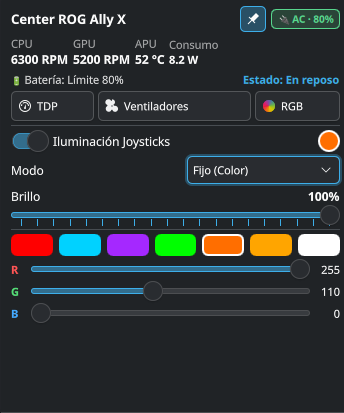
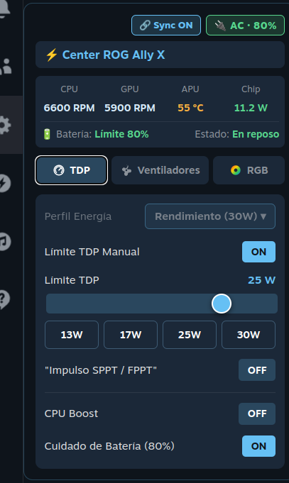
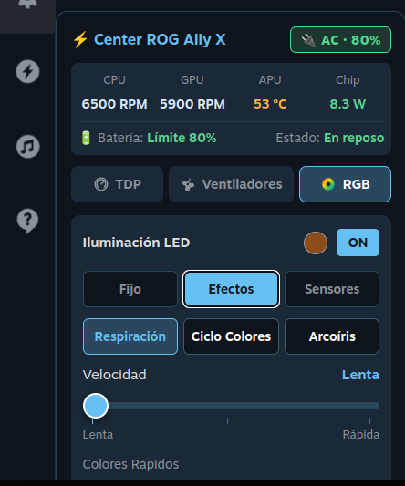
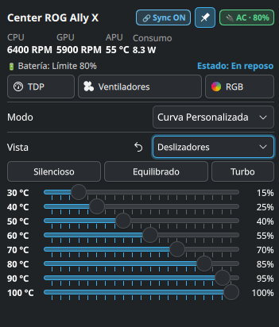
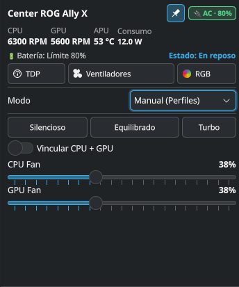
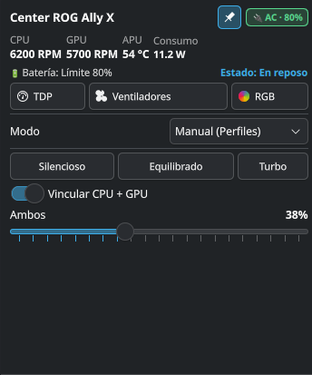
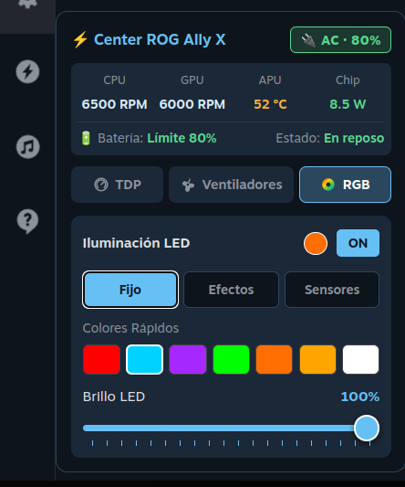

🌐 **Language / Idioma:** [Español](README.md) | **English**

<div align="center">
  
  <h1>⚡ Center ROG Ally / Ally X</h1>
  <p><strong>Native TDP, fan curve, and Aura RGB lighting control center for ASUS ROG Ally and ROG Ally X on Linux (KDE Plasma 6 + Steam Gaming Mode).</strong></p>
</div>

---

Inspired by the convenience of *Armoury Crate* and *Command Center*, this plasmoid lets you manage performance profiles, cooling curves, battery charge limits, and RGB lighting in real time straight from the desktop system tray **and natively inside Steam's Quick Access Menu (QAM) in Gaming Mode / Big Picture**, without relying on Decky Loader.

---

## 📸 Screenshots

### Desktop (KDE Plasma 6)

| TDP Control | Fan Curve | RGB Lighting |
| :---: | :---: | :---: |
|  |  |  |

### Gaming Mode (Steam QAM)

| TDP Control | Fan Curve | RGB Effects & Sensors |
| :---: | :---: | :---: |
|  |  |  |

<details>
<summary><b>🖼️ View all detailed views and modes (18 additional screenshots)</b></summary>
<br>

#### More views in KDE Plasma 6

| Power Profiles | BIOS Fans | Fan Sliders |
| :---: | :---: | :---: |
|  |  |  |

| Dual Fans | Single Fan | RGB Modes |
| :---: | :---: | :---: |
|  |  |  |

| RGB Color Cycle | RGB Breathing | RGB APU Temp | RGB Off |
| :---: | :---: | :---: | :---: |
|  |  |  |  |

#### More views in Gaming Mode (Steam QAM)

| Power Profiles | Fan Modes | BIOS Fans | Dual Fans |
| :---: | :---: | :---: | :---: |
|  |  |  |  |

| Single Fan | Linked Curve (All) | RGB Static Color | RGB Sensors |
| :---: | :---: | :---: | :---: |
|  |  |  |  |

</details>

---

## ✨ Key Features

* **🚀 Full TDP & Performance Control:**
  * Native kernel power profiles: **Silent**, **Balanced**, and **Performance**.
  * **Manual TDP Limit (SPL):** Fine-grained tuning from **7W to 30W** with quick-preset buttons (`13W`, `17W`, `25W`, `30W`).
  * **Dynamic Boost (SPPT / FPPT):** Switch between flat sustained wattage or temporary boost spikes (`35W` / `43W`).
  * **CPU Boost:** Toggle processor turbo boost on or off with a single click.
  * **Battery Care:** Cap maximum charge at **80%** or **100%** directly in ASUS firmware to extend battery lifespan.
* **🔄 Smart Mode Synchronization (`Sync ON` vs `Per-Mode`):**
  * **Synced Mode (`Sync ON`):** Keeps a single mirrored configuration across KDE Plasma Desktop and Steam Gaming Mode.
  * **Independent Profiles (`Per-Mode`):** Automatically saves and applies separate configurations (TDP, fan curves, CPU Boost, battery limit, and RGB) for **Desktop** and **Gaming Mode**.
  * **Active System Protection (`Anti-Override`):** Detects session transitions (`Gamescope ↔ KDE Plasma`), `plasma-powerdevil` startup, and power plug/unplug events (`AC ↔ Battery`), restoring your active user profile within < 1.5s so the OS never silently resets your TDP.
* **❄️ Independent Fan Curves (CPU & GPU):**
  * Granular **8-point temperature control** (`30°C` to `100°C`) independently configurable per fan.
  * Built-in presets: **Silent**, **Balanced**, and **Turbo**, plus one-click restoration to factory **Auto** mode.
  * **Anti-Loop Lock:** Smart input locking while dragging curve points to prevent slider bounce or value jitter.
* **🌈 Advanced RGB Lighting Control:**
  * Visual color picker with live preview, adjustable brightness (`0%–100%`), and animation speed (`Slow`, `Medium`, `Fast`).
  * Native hardware effects: **Static**, **Breathing**, **Rainbow**, and **Strobe**.
  * **Smart Software Modes:**
    * *By Temperature:* Smoothly shifts from green to red based on live APU temperature.
    * *By Battery:* Reflects remaining battery level through color gradients.
    * *By Time of Day:* Automatically adapts lighting to morning, afternoon, evening, and night periods.
* **📊 Real-Time Hardware Telemetry:**
  * Direct kernel `hwmon` sensor readings: **RPM** for both fans, **APU** temperature, instantaneous power draw in **Watts (W)**, **battery** percentage, and charging (`AC`) status.
* **🕹️ Native Gaming Mode Integration (No Decky Loader Required):**
  * Automatically injects a native control panel into SteamOS / Big Picture's Quick Access Menu (`QuickAccess`) via Steam CEF WebSocket, keeping state and controls synced in real time with the desktop widget.
* **🪶 Ultra-Lightweight Footprint:**
  * Background daemon engineered with state caching and thermal hysteresis: steady **~15–22 MB RAM** footprint and **< 0.05% average CPU** usage, with zero memory leaks.
* **🌐 Automatic Multi-Language Support:**
  * Automatically detects your system locale and adapts both Desktop and Gaming Mode UIs to **English, Spanish, Portuguese, French, German, Japanese, and Simplified Chinese** (falling back to **English** for any other locale).

---

## 💻 Compatibility & Requirements

### Hardware

| Device | Status | Details |
| :--- | :---: | :--- |
| **ASUS ROG Ally X** (`RC72LA`) | ✅ **Verified** | Full support: TDP (up to 30W AC / 25W Battery), custom fan curves, 80% battery charge limit, telemetry, and RGB control. |
| **ASUS ROG Ally** (`RC71L` - Z1 / Z1 Extreme) | 🟡 **Compatible** | Shares the exact same kernel architecture (`asus-armoury` & HID LEDs). Pending physical verification on original hardware. |
| **ROG Xbox Ally / Xbox Ally X** (`RC73YA` / `RC73XA`) | ⚠️ **Experimental** | TDP, fans, and battery limit work on Linux kernel ≥ 6.19; RGB uses a different USB HID ID and is not supported yet. |

### Operating System & Environment
* **Linux Distributions:** **CachyOS**, **Bazzite**, **Arch Linux**, or derivatives running **Linux Kernel 6.13+** (requires `asus-armoury` module and `amdgpu` driver).
* **Desktop Environment:** **KDE Plasma 6** (for the native desktop plasmoid).
* **Gaming Mode:** **Steam Big Picture** / **Gamescope Session** (requires Steam running with `--remote-debugging-port=8080`).
* **Dependencies:** `python3`, `python-websockets` (or `python3-websockets`), `bash`, `sudo`, and `systemd`.

---

## 🏗️ Project Architecture

The system is decoupled into four layers to ensure responsiveness, low overhead, and privilege isolation:

1. **Privileged Backend (`ally_center.py`):** Python script interfacing directly with `/sys/class/firmware-attributes/asus-armoury/` and `/sys/class/leds/ally:rgb:joystick_rings/`. Handles persistent configuration in `/etc/ally-center.json` and runs passwordless via a scoped `sudoers` rule.
2. **Fast Sensor Monitor (`estado.sh`):** Lightweight Bash script reading temperatures, fan RPMs, power draw, and hardware state without adding CPU overhead.
3. **Desktop UI (`main.qml`):** Native KDE Plasma 6 QML plasmoid that updates reactively and dispatches asynchronous commands.
4. **Gaming Mode Bridge & Watcher (`ally_steam_bridge.py`):** Background user daemon (`systemd --user`, ordered after `plasma-powerdevil.service`) connecting via WebSocket to Steam's CEF debugging port (`127.0.0.1:8080`), injecting the QAM panel, detecting `Gamescope ↔ Plasma` transitions, and protecting user TDP settings against external power overrides.

---

## 🚀 Installation

1. Clone this repository onto your device:
   ```bash
   git clone https://github.com/Godblackk/ally-center-kde
   cd ally-center-kde
   ```

2. Run the automated installer (it will prompt for your administrator password once to configure permissions and services):
   ```bash
   chmod +x install.sh
   ./install.sh
   ```

3. **Add the widget in KDE Plasma:**
   * Right-click your taskbar / panel → **Add Widgets...**
   * Search for **"Center ROG Ally X"** and add it to your panel or system tray.

---

## 🗑️ Uninstallation

To cleanly remove the plasmoid, background services, `sudoers` rules, and configuration files:

```bash
chmod +x uninstall.sh
./uninstall.sh
```
