# Center ROG Ally (KDE Plasma 6 + Steam Modo Juego)

> **⚠️ EXCLUSIVO PARA ASUS ROG ALLY / ROG ALLY X:** Diseñado **únicamente** para consolas **ASUS ROG Ally (RC71L)** y **ROG Ally X (RC72LA)** en Linux mediante controladores del kernel específicos de ASUS (`asus-armoury`, `asus_custom_fan_curve`, HID/LED). No es compatible con Steam Deck, Lenovo Legion Go u otros dispositivos.

Centro de control nativo para **ASUS ROG Ally** y **ROG Ally X** en Linux (**KDE Plasma 6** y **Steam Modo Juego / Gamescope**).

## Características principales

- **Detección automática de hardware:** Identifica el modelo exacto y el estado de alimentación (`AC` / `BAT` con porcentaje).
- **Telemetría en tiempo real:** Monitorea RPM de ventiladores, temperatura de la APU (°C), consumo del chip (W) y telemetría de batería (`BAT0`: Watts, tiempo restante y potencia de carga).
- **Perfiles de ASUS y TDP dinámico:** Incluye perfiles *Ahorro (13W)*, *Equilibrado (17W)* y *Rendimiento*, además de límite TDP Manual (`7W–30W`) sincronizado con Boost Pico y cuidado de batería (80%).
- **Control de ventiladores:** Modos *Automático*, *Manual* (Silencioso, Equilibrado, Turbo) y *Curva Personalizada* de 8 puntos.
- **Iluminación RGB:** Modos dinámicos (Color Fijo, Temperatura APU, Nivel de Batería, Hora del Día) con control de brillo.
- **Integración con Steam Modo Juego:** Tarjeta táctil en las configuraciones rápidas (`... → ⚙️`) vía CEF (`ally_steam_bridge.py`), dividida en sub-pestañas (*TDP* | *Ventiladores* | *RGB*).
- **Iconos dinámicos y persistencia:** Iconos de barra de tareas según el perfil activo y servicio `systemd` para guardar ajustes en `/etc/ally-center.json`.

## Arquitectura del sistema

El proyecto utiliza una arquitectura desacoplada donde **KDE Plasma 6** y el **Modo Juego de Steam** comparten un backend y estado persistente en tiempo real:

1. **Interfaz KDE Plasma 6 (`contents/ui/main.qml`):** Plasmoide nativo QML/Kirigami para el panel de escritorio con control de energía, ventiladores y RGB.
2. **Puente Steam Modo Juego (`contents/scripts/ally_steam_bridge.py`):** Servicio de usuario (`systemd --user`) que se conecta vía WebSocket al depurador CEF de Steam (`localhost:8080`) e inyecta una tarjeta táctil compacta (`TDP` | `Ventiladores` | `RGB`) en las **Configuraciones rápidas (`... → ⚙️`)**, sin requerir Decky Loader.
3. **Backend de Hardware (`ally_center.py` y `estado.sh`):** Lee y aplica cambios de hardware (sensores en `/sys/class/hwmon`, `asus-armoury`, `cpufreq`, `BAT0`) mediante bloqueo exclusivo (`flock`) persistiendo en `/etc/ally-center.json`.
4. **Sincronización (`/etc/ally-center.json` + `ally-center.service`):** Logra sincronización bidireccional y restauración automática al arrancar.

## Instalación rápida

1. Clona el repositorio y ejecuta el instalador en KDE Plasma:
   ```bash<div align="center">
  
  <h1>⚡ Center ROG Ally / Ally X</h1>
  <p><strong>Centro de control nativo de TDP, curvas de ventilación e iluminación RGB Aura para ASUS ROG Ally y ROG Ally X en Linux (KDE Plasma 6 + Steam Modo Juego).</strong></p>
</div>

---

## ✨ Características Principales

* **Doble Entorno Sincronizado en Tiempo Real:** Funciona de forma nativa como **Plasmoide en KDE Plasma 6** y se integra directamente dentro del **Menú Rápido (`...` Quick Access Menu) de Steam Modo Juego** sin depender de Decky Loader ni plugins de terceros.
* **Control Térmico y TDP Avanzado:**
  * Perfiles rápidos (`Ahorro 13W`, `Equilibrado 17W`, `Rendimiento 30W`) integrados con `power-profiles-daemon`.
  * **Límite TDP Manual (`7W – 30W`)** con botones de acceso rápido (`13W`, `17W`, `25W`, `30W`).
  * **Impulso SPPT / FPPT** para picos sostenidos (`35W – 43W` en batería / `43W – 53W` conectado a corriente).
  * Interruptores dedicados para **CPU Boost** y **Cuidado de Batería (Límite de carga al 80%)**.
* **Gestión Completa de Ventiladores (`CPU` y `GPU`):**
  * **Automático (BIOS):** Delega el control térmico al firmware nativo.
  * **Manual (Perfiles y Velocidad Fija):** Perfiles instantáneos (`Silencioso`, `Equilibrado`, `Turbo`) y control de velocidad unificado o independiente (`CPU Fan` / `GPU Fan`).
  * **Curva Personalizada de 8 Puntos (`30 °C – 100 °C`):** Editor gráfico táctil en KDE Plasma y deslizadores de precisión en Modo Juego con modos **Cascada**, **Todos juntos** y perfiles predefinidos.
* **Iluminación RGB Aura de Joysticks (`HID MCU`):**
  * Comunicación directa por USB HID (`/dev/hidraw*`) con el microcontrolador de los joysticks.
  * **Color Fijo** con paleta calibrada y control de brillo (`5% – 100%`).
  * **Efectos Dinámicos:** `Respiración`, `Ciclo de Colores` y `Arcoíris` con selector de velocidad (`Lenta`, `Media`, `Rápida`).
  * **Sensores Reactivos en Tiempo Real:**
    * **Temperatura APU** (con histéresis de `2 °C` para evitar parpadeos en fronteras térmicas).
    * **Nivel de Batería** (4 tramos con aviso crítico `≤ 10%` en rojo y verde automático al conectar el cargador).
    * **Ciclo Horario** (Mañana blanco, Tarde cian, Noche rojo anti-deslumbramiento).
* **Persistencia Total:** Servicio `systemd` de arranque (`ally-center.service`) y hook `system-sleep` que restauran automáticamente el perfil TDP, la curva de ventilación y el estado RGB al encender o despertar la consola de suspensión.

---

## 🏗️ Arquitectura del Sistema

El proyecto está diseñado bajo una arquitectura desacoplada en **4 capas**, garantizando consumo mínimo de recursos (`< 0.4%` de CPU y `~21 MB` de RAM) y sincronización bidireccional entre el escritorio y el modo consola:

```text
┌─────────────────────────────────────┐    ┌──────────────────────────────────────────┐
│        KDE Plasma 6 (QML UI)        │    │     Steam Modo Juego (Quick Access)      │
│  org.ally.center/contents/ui/main   │    │  Inyección DOM/JS vía Steam CEF (:8080)  │
└──────────────┬──────────────────────┘    └────────────────────┬─────────────────────┘
               │ (Lectura 2s / Comandos)                        │ (WebSocket Bidireccional)
               ▼                                                ▼
┌──────────────────────────┐               ┌──────────────────────────────────────────┐
│        estado.sh         │               │          ally_steam_bridge.py            │
│  Telemetría sysfs/JSON   │               │  Demonio usuario + refresco RGB sensores │
└──────────────┬───────────┘               └────────────────────┬─────────────────────┘
               │                                                │
               └───────────────────────┬────────────────────────┘
                                       │ sudo (NOPASSWD vía /etc/sudoers.d/ally-center)
                                       ▼
                     ┌──────────────────────────────────┐
                     │          ally_center.py          │
                     │  Backend CLI & Estado Persistente│
                     │      (/etc/ally-center.json)     │
                     └─────────────────┬────────────────┘
                                       │
                 ┌─────────────────────┼─────────────────────┐
                 ▼                     ▼                     ▼
   ┌──────────────────────────┐ ┌─────────────┐ ┌──────────────────────────┐
   │   asus-armoury / WMI     │ │   hwmon     │ │   USB HID (/dev/hidraw*) │
   │ PPT SPL/SPPT/FPPT, Boost │ │ Curvas PWM  │ │ Protocolo Aura MCU LEDs  │
   └──────────────────────────┘ └─────────────┘ └──────────────────────────┘
```

### Componentes Clave
1. **`ally_center.py` (Backend Core):** Centraliza toda la lógica de hardware y guarda la configuración activa en `/etc/ally-center.json`. Aplica los valores de potencia PPT (`stapm`, `fast`, `slow`), curvas térmicas de 8 puntos en `hwmon` y tramas binarias HID al controlador Aura de los joysticks.
2. **`estado.sh` (Recolector de Telemetría):** Script ligero que consulta sensores del kernel (`hwmon`, `BAT0`, `AC0`, RPM de CPU/GPU) y los combina con `/etc/ally-center.json` para alimentar la interfaz QML sin bloquear la UI.
3. **`main.qml` (Interfaz KDE Plasma 6):** Plasmoide nativo escrito en QML + Kirigami con soporte táctil y de ratón, editor gráfico interactivo de curvas (`Canvas`) e indicador LED animado en vivo.
4. **`ally_steam_bridge.py` (Puente Nativo Steam CEF):** Servicio `systemd` de usuario que habilita la depuración local oficial de Steam (`.cef-enable-remote-debugging` en `127.0.0.1:8080`), detecta el panel `QuickAccess` vía WebSocket e inyecta la interfaz nativa sincronizada.

---

## 📸 Galería de Capturas

### 🎮 Steam Modo Juego (Quick Access Menu)

| Control de TDP y Energía | Curva de Ventiladores | Control RGB Aura |
| :---: | :---: | :---: |
| 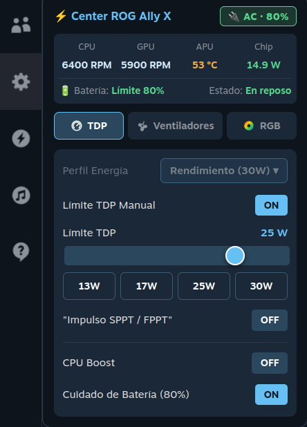 |  | 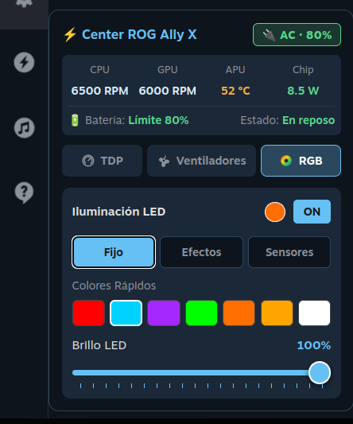 |

<details>
<summary><strong>Ver más capturas de Steam Modo Juego (Perfiles, Ventilación Dual/BIOS y Efectos RGB)</strong></summary>
<br>

| Perfiles de Energía | Desplegable Modos Ventilación | Curva Todos Juntos |
| :---: | :---: | :---: |
|  |  | 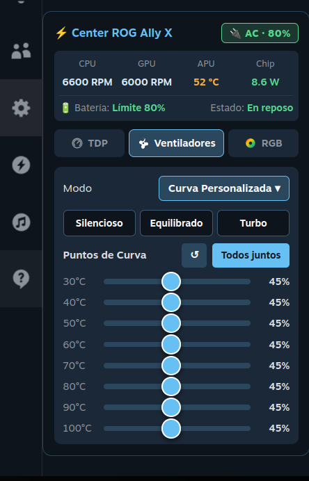 |

| Ventilación Automática (BIOS) | Ventilación Manual Unificada | Ventilación Manual Independiente |
| :---: | :---: | :---: |
|  | 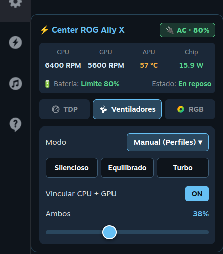 | 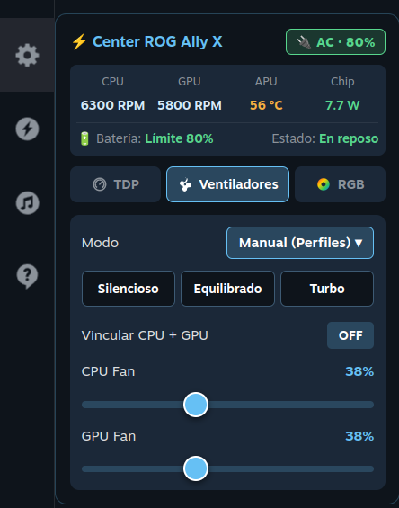 |

| Efectos RGB y Velocidad | Sensores RGB Reactivos |
| :---: | :---: |
| 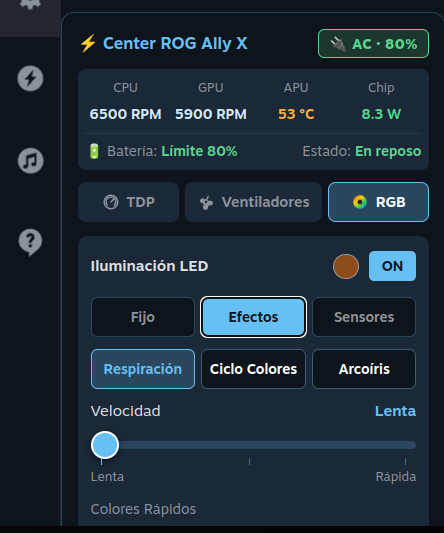 | 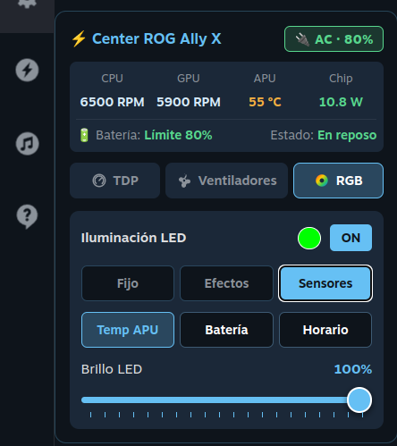 |

</details>

---

### 🖥️ Escritorio KDE Plasma 6

| Control de TDP y Energía | Editor Gráfico de Curva | Control RGB Aura |
| :---: | :---: | :---: |
| 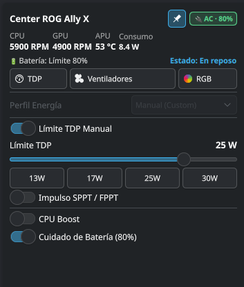 | 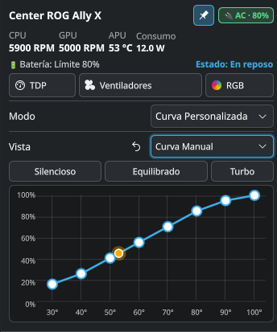 | 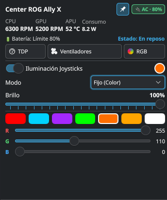 |

<details>
<summary><strong>Ver más capturas de KDE Plasma 6 (Perfiles, Ventilación y Modos RGB)</strong></summary>
<br>

| Perfiles de Energía KDE | Curva Deslizadores KDE | Ventilación Automática (BIOS) |
| :---: | :---: | :---: |
|  | 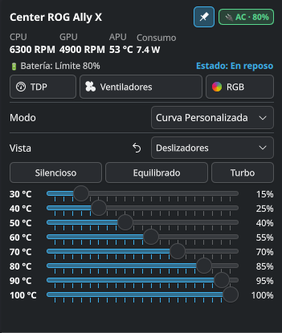 | 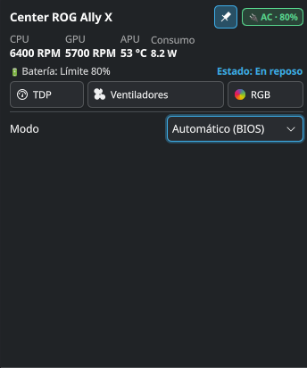 |

| Ventilación Manual Única | Ventilación Manual Dual | Modos y Sensores RGB |
| :---: | :---: | :---: |
| 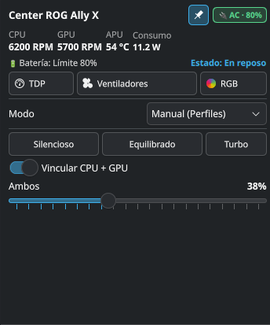 | 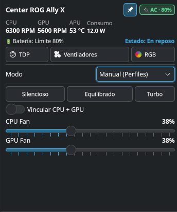 |  |

| Efecto Respiración | Ciclo de Colores | Sensor Temperatura APU |
| :---: | :---: | :---: |
| 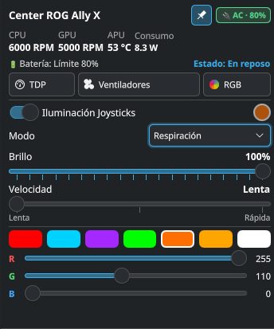 | 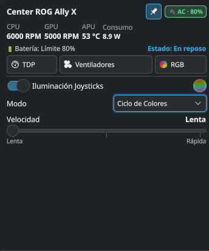 |  |

</details>

---

## 🚀 Instalación y Desinstalación

### Requisitos Previos
* **Hardware:** ASUS ROG Ally (Z1 / Z1 Extreme) o ROG Ally X.
* **Sistema Operativo:** Distribución Linux con **KDE Plasma 6** (ej. CachyOS Handheld, Bazzite, SteamOS / Arch Linux) y kernel con soporte `asus-nb-wmi` / `asus-armoury`.
* **Dependencias:** `python3`, `python-websockets` (instalada automáticamente por el script si falta).


### Compatibilidad de Hardware y Sistemas

| Modelo | Estado | Notas |
| :--- | :---: | :--- |
| **ROG Ally X (2024)** | ✅ **100% Probado** | TDP, SPPT/FPPT, curvas duales, batería 80%, RGB Aura y Modo Juego. |
| **ROG Ally Z1 / Z1 Extreme (2023)** | ✅ **Compatible** | Soporte completo de TDP, ventiladores, batería (`BATT`/`BAT0`) y RGB Aura. |
| **ROG Xbox Ally / Xbox Ally X (2025)** | ⚠️ **Experimental** | Requiere kernel Linux `6.15+` con soporte `asus-armoury` reciente. |

* **Distribuciones soportadas:** CachyOS Handheld, Bazzite-Deck (KDE Plasma), Nobara Handheld (KDE Plasma), Arch / EndeavourOS (KDE Plasma 6) y SteamOS 3 (con `steamos-readonly disable`).


### Instalación Rápida
Clona el repositorio y ejecuta `./install.sh` como tu usuario normal (**sin `sudo`**; el script solicitará permisos cuando configure `systemd` y `sudoers`):

```bash
git clone https://github.com
cd ally-center-kde
chmod +x install.sh uninstall.sh
./install.sh
```

Luego haz clic derecho en el panel de KDE Plasma → **Añadir o gestionar widgets** → busca **Center ROG Ally** y fíjalo en tu barra de tareas. En **Steam Modo Juego**, aparecerá automáticamente al final del menú rápido (`...`).

### Desinstalación Limpia
Para eliminar por completo el widget, los servicios `systemd`, las reglas `sudoers` y el icono del sistema:

```bash
./uninstall.sh
```

   git clone https://github.com/Godblackk/ally-center-kde.git
   cd ally-center-kde
   ./install.sh
   ```
2. Introduce tu contraseña (`sudo`) para configurar permisos y servicios.
3. Haz **clic derecho** en la barra de tareas de KDE → **Añadir o gestionar widgets** → selecciona **Center ROG Ally**.

## ¿Qué configura automáticamente `./install.sh`?

- **Widget de Plasma 6:** Instala `org.ally.center` mediante `kpackagetool6`.
- **Permisos sin contraseña:** Crea `/etc/sudoers.d/ally-center` para ajustar hardware sin pedir `sudo`.
- **Persistencia:** Configura `ally-center.service`, el hook de suspensión (`systemd-sleep`) y el puente de Steam (`ally-steam-bridge.service`).

## Actualización y desinstalación

- **Actualizar:** `cd ~/ally-center-kde && git pull && ./install.sh`
- **Desinstalar:** `cd ~/ally-center-kde && ./uninstall.sh`

## Compatibilidad (ASUS ROG Ally / ROG Ally X)

- **CachyOS / Arch Linux / EndeavourOS (KDE Plasma 6):** Soporte nativo completo.
- **Bazzite / SteamOS (KDE Plasma 6):** Compatible (evita solapar con *Handheld Daemon* en Bazzite; reejecuta `./install.sh` tras grandes actualizaciones de SteamOS).
- **GNOME:** No compatible.
