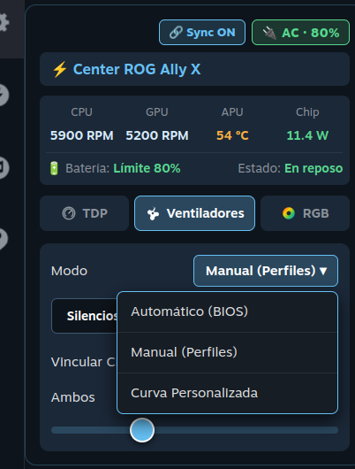
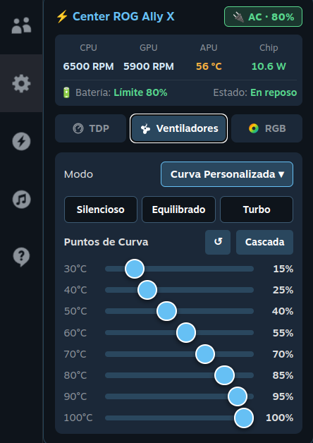
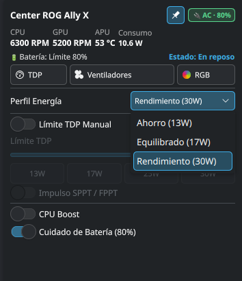
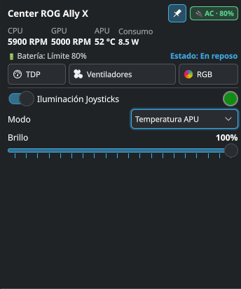

🌐 **Idioma / Language:** **Español** | [English](README.en.md)

<p align="center">
  
</p>

# ⚡ Center ROG Ally / Ally X

**Center ROG Ally / Ally X** es un centro de control nativo de energía, curvas térmicas de ventiladores e iluminación RGB diseñado específicamente para las consolas **ASUS ROG Ally** y **ROG Ally X** bajo entornos de escritorio **KDE Plasma 6** (como CachyOS, Bazzite o Arch Linux) y **Steam Gaming Mode** (Gamescope).

El proyecto ofrece una interfaz limpia, minimalista y sin procesos pesados en segundo plano, comunicándose directamente con las interfaces del kernel de Linux (`asus-armoury`, `asus_custom_fan_curve` y dispositivos HID `hidraw`).

---

## 📸 Capturas de Pantalla

### 🎮 Modo Juego (Decky Loader Plugin)

#### ⚡ Energía y TDP

| Perfiles de Energía (13W / 17W / 30W) | Límite TDP Manual, Boost y Cuidado Batería |
| :---: | :---: |
|  |  |

#### 🌀 Control de Ventiladores

| Selector de Modos | Automático (BIOS) |
| :---: | :---: |
|  |  |

| Manual Vinculado (CPU + GPU) | Manual Independiente (CPU / GPU) |
| :---: | :---: |
|  |  |

| Curva Personalizada (Modo Cascada) | Curva Personalizada (Todos Juntos) |
| :---: | :---: |
|  |  |

#### 🌈 Iluminación RGB de Joysticks

| Color Fijo y Brillo | Efectos Dinámicos | Sensores Inteligentes |
| :---: | :---: | :---: |
|  |  |  |

---

### 🖥️ Modo Escritorio (KDE Plasma 6 Widget)

#### ⚡ Energía y TDP

| Perfiles Predefinidos | Ajuste Manual (4W – 30W) |
| :---: | :---: |
|  |  |

#### 🌀 Control de Ventiladores

| Automático (BIOS) | Manual Vinculado | Manual Independiente |
| :---: | :---: | :---: |
|  |  |  |

| Curva Gráfica Interactiva (8 Puntos) | Vista por Deslizadores (30°C – 100°C) |
| :---: | :---: |
|  |  |

#### 🌈 Iluminación RGB y Selector R/G/B

| Selector de Modos RGB | Color Fijo + Sliders R/G/B | Efecto Respiración |
| :---: | :---: | :---: |
|  |  |  |

| Ciclo de Colores | Sensor Temperatura APU | Iluminación Apagada |
| :---: | :---: | :---: |
|  |  |  |

---

## ✨ Características Principales

* **⚡ Control de Energía y TDP en Tiempo Real:**
  * Perfiles rápidos del sistema: **Silencioso**, **Equilibrado** y **Rendimiento**.
  * Presets instantáneos de consumo (**13W**, **17W**, **25W**, **30W** / **35W** en Ally X).
  * Ajuste granular independiente para los límites **SPL** (sostenido), **SPPT** (boost de 2 minutos) y **FPPT** (boost de 10 segundos).
  * Activación y desactivación directa de **CPU Turbo Boost** y límite de carga de batería al **80%**.
* **🌀 Gestión Térmica y Ventiladores:**
  * **Modo Automático:** Deja el control al firmware de ASUS.
  * **Modo Manual:** Velocidad fija del 25% al 100%, con opción para vincular o controlar de forma independiente el ventilador de **CPU** y **GPU** (incluso tras reiniciar o despertar de suspensión).
  * **Curva Personalizada de 8 Puntos:** Editor interactivo de temperatura (°C) vs velocidad (%) con perfiles predefinidos (*Silenciosa*, *Equilibrada*, *Turbo*).
* **🌈 Iluminación RGB de los Joysticks:**
  * Control por hardware mediante paquetes HID directos (`/dev/hidraw*`).
  * Efectos nativos: **Fijo**, **Respiración**, **Ciclos**, **Arcoíris** y **Pulso**.
  * Selector de colores rápidos y barra de brillo ajustable.
* **🕹️ Integración Nativa en Modo Juego (Sin Decky Loader):**
  * Se integra automáticamente como una pestaña nativa dentro del **Menú de Acceso Rápido (QAM / botón `···`)** de Steam en *Gaming Mode* mediante inyección CEF, mostrando telemetría en tiempo real (CPU, GPU, batería, consumo y temperaturas) sin depender de Decky Loader.
* **🎮 Navegación 100 % Nativa con Mando en Modo Juego:**
  * Control total del panel sin necesidad de pantalla táctil ni ratón: **Cruceta / Stick Izquierdo (`↑`/`↓`)** para moverte entre secciones, **`A`** para entrar y aplicar ajustes al instante, **`←`/`→`** para regular deslizadores y presets, y **`B`** para salir de cada bloque o cerrar el menú sin interferir con Steam.
* **🛡️ Persistencia Automática y Vigilancia Inteligente:**
  * Guarda tu configuración en `/etc/ally-center.json` y la restaura automáticamente al arrancar el sistema o despertar de suspensión mediante servicios `systemd`.
  * Un vigilante inteligente evita que el sistema operativo sobrescriba tu TDP o perfil personalizado al conectar o desconectar el cargador.
* **🌍 Soporte Multilenguaje:** Interfaz traducida automáticamente al **Español** e **Inglés** según el idioma de tu sesión.
---

## 🏗️ Arquitectura del Proyecto

1. **Backend Privilegiado (`ally_center.py`):** Script en Python que interactúa directamente con `/sys/class/firmware-attributes/asus-armoury/` (TDP y perfiles), `asus_custom_fan_curve` (curvas térmicas) y mediante paquetes HID directos por `/dev/hidraw*` para la iluminación RGB (`0x1B4C` / `0x1ABE`). Gestiona la persistencia en `/etc/ally-center.json` y se ejecuta sin contraseña mediante una regla de `sudoers`.
2. **Interfaz de Escritorio (`main.qml`):** Plasmoid nativo construido para **KDE Plasma 6** (Kirigami / PlasmaComponents3), ligero y adaptable al tema de color del sistema.
3. **Puente de Modo Juego (`ally_steam_bridge.py`):** Servicio ligero de usuario (`systemd --user`) que se conecta por WebSocket al puerto de depuración local de Steam (`127.0.0.1:8080`) para inyectar la pestaña nativa en el QAM y gestionar la navegación con mando.

> Para más detalles técnicos sobre rutas `sysfs`, protocolos HID y flujo de servicios, consulta [ARQUITECTURA.md](ARQUITECTURA.md).

---

## 💻 Compatibilidad y Requisitos

* **Hardware Soportado:**
  * ✅ **ASUS ROG Ally X (`RC72LA`)** — *Soporte completo.*
  * ✅ **ASUS ROG Ally (`RC71L` — Ryzen Z1 / Z1 Extreme)** — *Soporte completo con ajuste automático de límites TDP y PID RGB (`0x1ABE`).*
  * ⚠️ **ROG Xbox Ally / Xbox Ally X (`RC73YA` / `RC73XA`)** — *TDP y ventiladores compatibles vía `asus-armoury`; el control RGB requiere actualización de ID HID en el kernel.*
* **Sistemas Operativos:**
  * **CachyOS (Handheld Edition)** *(Probado y recomendado)*
  * **Bazzite (KDE)** *(Compatible — instalación en espacio de usuario respetando sistema inmutable)*
  * **Arch Linux / SteamOS 3.7+ / EndeavourOS / Nobara (KDE)**
* **Requisitos del Sistema:**
  * **Linux Kernel ≥ 6.13** (con módulos `asus-armoury` y `asus_custom_fan_curve` activos).
  * **KDE Plasma 6.0** o superior.
  * **Dependencias:** `python3`, `python-websockets` (el instalador la configura automáticamente si falta).

### ⚠️ Nota sobre Otros Gestores de Control

> **Evita ejecutar múltiples gestores de hardware al mismo tiempo:**  
> Si tienes instalados otros servicios que controlan el TDP, los ventiladores o la iluminación RGB (como **Handheld Daemon / HHD**, **SimpleDeckyTDP**, **PowerTools** o **OpenRGB**), ambos intentarán aplicar sus propios valores sobre el hardware simultáneamente, lo que puede provocar que los ajustes se sobrescriban entre sí o cambien de forma inesperada.  
> Para una experiencia estable, desactiva el control de TDP, ventiladores y RGB en otras herramientas antes de usar **Center ROG Ally / Ally X**.

---

## 🚀 Instalación

1. Clona este repositorio en tu consola:
   ```bash
   git clone https://github.com/Godblackk/ally-center-kde
   cd ally-center-kde
   ```

2. Ejecuta el script de instalación:
   ```bash
   chmod +x install.sh
   ./install.sh
   ```

3. Añade el widget a tu panel de KDE Plasma:
   * Haz clic derecho sobre la barra de tareas → **Entrar en modo edición** → **Añadir elementos gráficos...**
   * Busca **Center ROG Ally / Ally X** y arrástralo a tu panel.

---

## 🗑️ Desinstalación

Si deseas eliminar por completo el widget, las reglas de `sudoers`, los servicios `systemd` y la configuración guardada:

```bash
chmod +x uninstall.sh
./uninstall.sh
```

---

## 📄 Licencia

Este proyecto se distribuye bajo la licencia **GNU General Public License v3.0 (GPLv3)**. Consulta el archivo [LICENSE](LICENSE) para más detalles.
