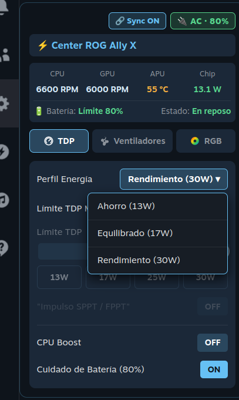
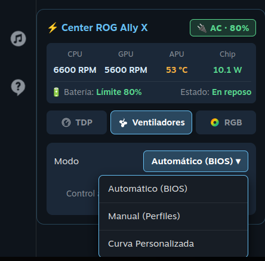
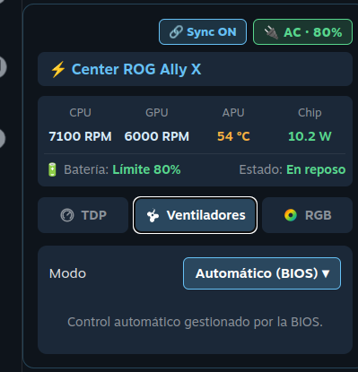
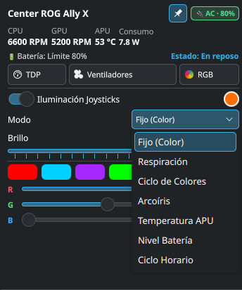

<div align="center">
  
  <h1>⚡ Center ROG Ally / Ally X</h1>
  <p><strong>Centro de control nativo de TDP, curvas de ventilación e iluminación RGB Aura para ASUS ROG Ally y ROG Ally X en Linux (KDE Plasma 6 + Steam Modo Juego).</strong></p>
</div>

---


---

## 🏗️ Arquitectura del Sistema

El proyecto está diseñado bajo una arquitectura desacoplada en **4 capas**, garantizando consumo mínimo de recursos (`< 0.4%` de CPU y `~21 MB` de RAM) y sincronización bidireccional entre el escritorio y el modo consola:

```text
┌─────────────────────────────────────┐    ┌──────────────────────────────────────────┐
│        KDE Plasma 6 (QML UI)        │    │     Steam Modo Juego (Quick Access)      │
│  org.ally.center/contents/ui/main   │    │  Inyección DOM/JS vía Steam CEF (:8080)  │
└──────────────┬──────────────────────┘    └────────────────────┬─────────────────────┘
               │ (Lectura 2s / Comandos)                        │ (WebSocket Bidireccional)
               ▼                                                ▼
┌──────────────────────────┐               ┌──────────────────────────────────────────┐
│        estado.sh         │               │          ally_steam_bridge.py            │
│  Telemetría sysfs/JSON   │               │  Demonio usuario + refresco RGB sensores │
└──────────────┬───────────┘               └────────────────────┬─────────────────────┘
               │                                                │
               └───────────────────────┬────────────────────────┘
                                       │ sudo (NOPASSWD vía /etc/sudoers.d/ally-center)
                                       ▼
                     ┌──────────────────────────────────┐
                     │          ally_center.py          │
                     │  Backend CLI & Estado Persistente│
                     │      (/etc/ally-center.json)     │
                     └─────────────────┬────────────────┘
                                       │
                 ┌─────────────────────┼─────────────────────┐
                 ▼                     ▼                     ▼
   ┌──────────────────────────┐ ┌─────────────┐ ┌──────────────────────────┐
   │   asus-armoury / WMI     │ │   hwmon     │ │   USB HID (/dev/hidraw*) │
   │ PPT SPL/SPPT/FPPT, Boost │ │ Curvas PWM  │ │ Protocolo Aura MCU LEDs  │
   └──────────────────────────┘ └─────────────┘ └──────────────────────────┘
```

### Componentes Clave
1. **`ally_center.py` (Backend Core):** Centraliza toda la lógica de hardware y guarda la configuración activa en `/etc/ally-center.json`. Aplica los valores de potencia PPT (`stapm`, `fast`, `slow`), curvas térmicas de 8 puntos en `hwmon` y tramas binarias HID al controlador Aura de los joysticks.
2. **`estado.sh` (Recolector de Telemetría):** Script ligero que consulta sensores del kernel (`hwmon`, `BAT0`, `AC0`, RPM de CPU/GPU) y los combina con `/etc/ally-center.json` para alimentar la interfaz QML sin bloquear la UI.
3. **`main.qml` (Interfaz KDE Plasma 6):** Plasmoide nativo escrito en QML + Kirigami con soporte táctil y de ratón, editor gráfico interactivo de curvas (`Canvas`) e indicador LED animado en vivo.
4. **`ally_steam_bridge.py` (Puente Nativo Steam CEF):** Servicio `systemd` de usuario que habilita la depuración local oficial de Steam (`.cef-enable-remote-debugging` en `127.0.0.1:8080`), detecta el panel `QuickAccess` vía WebSocket e inyecta la interfaz nativa sincronizada.

---

## 📸 Galería de Capturas

### 🎮 Steam Modo Juego (Quick Access Menu)

| Control de TDP y Energía | Curva de Ventiladores | Control RGB Aura |
| :---: | :---: | :---: |
|  |  |  |

<details>
<summary><strong>Ver más capturas de Steam Modo Juego (Perfiles, Ventilación Dual/BIOS y Efectos RGB)</strong></summary>
<br>

| Perfiles de Energía | Desplegable Modos Ventilación | Curva Todos Juntos |
| :---: | :---: | :---: |
|  |  |  |

| Ventilación Automática (BIOS) | Ventilación Manual Unificada | Ventilación Manual Independiente |
| :---: | :---: | :---: |
|  |  |  |

| Efectos RGB y Velocidad | Sensores RGB Reactivos |
| :---: | :---: |
|  |  |

</details>

---

### 🖥️ Escritorio KDE Plasma 6

| Control de TDP y Energía | Editor Gráfico de Curva | Control RGB Aura |
| :---: | :---: | :---: |
|  |  |  |

<details>
<summary><strong>Ver más capturas de KDE Plasma 6 (Perfiles, Ventilación y Modos RGB)</strong></summary>
<br>

| Perfiles de Energía KDE | Curva Deslizadores KDE | Ventilación Automática (BIOS) |
| :---: | :---: | :---: |
|  |  |  |

| Ventilación Manual Única | Ventilación Manual Dual | Modos y Sensores RGB |
| :---: | :---: | :---: |
|  |  |  |

| Efecto Respiración | Ciclo de Colores | Sensor Temperatura APU |
| :---: | :---: | :---: |
|  |  |  |

</details>

---

## 🚀 Instalación y Desinstalación

### Requisitos Previos
* **Hardware:** ASUS ROG Ally (Z1 / Z1 Extreme) o ROG Ally X.
* **Sistema Operativo:** Distribución Linux con **KDE Plasma 6** (ej. CachyOS Handheld, Bazzite, SteamOS / Arch Linux) y kernel con soporte `asus-nb-wmi` / `asus-armoury`.
* **Dependencias:** `python3`, `python-websockets` (instalada automáticamente por el script si falta).


### Compatibilidad de Hardware y Sistemas

| Modelo | Estado | Notas |
| :--- | :---: | :--- |
| **ROG Ally X (2024)** | ✅ **100% Probado** | TDP, SPPT/FPPT, curvas duales, batería 80%, RGB Aura y Modo Juego. |
| **ROG Ally Z1 / Z1 Extreme (2023)** | ✅ **Compatible** | Soporte completo de TDP, ventiladores, batería (`BATT`/`BAT0`) y RGB Aura. |
| **ROG Xbox Ally / Xbox Ally X (2025)** | ⚠️ **Experimental** | Requiere kernel Linux `6.15+` con soporte `asus-armoury` reciente. |

* **Distribuciones soportadas:** CachyOS Handheld, Bazzite-Deck (KDE Plasma), Nobara Handheld (KDE Plasma), Arch / EndeavourOS (KDE Plasma 6) y SteamOS 3 (con `steamos-readonly disable`).


### Instalación Rápida
Clona el repositorio y ejecuta `./install.sh` como tu usuario normal (**sin `sudo`**; el script solicitará permisos cuando configure `systemd` y `sudoers`):

```bash
git clone https://github.com
cd ally-center-kde
chmod +x install.sh uninstall.sh
./install.sh
```

Luego haz clic derecho en el panel de KDE Plasma → **Añadir o gestionar widgets** → busca **Center ROG Ally** y fíjalo en tu barra de tareas. En **Steam Modo Juego**, aparecerá automáticamente al final del menú rápido (`...`).

### Desinstalación Limpia
Para eliminar por completo el widget, los servicios `systemd`, las reglas `sudoers` y el icono del sistema:

```bash
./uninstall.sh
```

   git clone https://github.com/Godblackk/ally-center-kde.git
   cd ally-center-kde
   ./install.sh
   ```
2. Introduce tu contraseña (`sudo`) para configurar permisos y servicios.
3. Haz **clic derecho** en la barra de tareas de KDE → **Añadir o gestionar widgets** → selecciona **Center ROG Ally**.

## ¿Qué configura automáticamente `./install.sh`?

- **Widget de Plasma 6:** Instala `org.ally.center` mediante `kpackagetool6`.
- **Permisos sin contraseña:** Crea `/etc/sudoers.d/ally-center` para ajustar hardware sin pedir `sudo`.
- **Persistencia:** Configura `ally-center.service`, el hook de suspensión (`systemd-sleep`) y el puente de Steam (`ally-steam-bridge.service`).

## Actualización y desinstalación

- **Actualizar:** `cd ~/ally-center-kde && git pull && ./install.sh`
- **Desinstalar:** `cd ~/ally-center-kde && ./uninstall.sh`

## Compatibilidad (ASUS ROG Ally / ROG Ally X)

- **CachyOS / Arch Linux / EndeavourOS (KDE Plasma 6):** Soporte nativo completo.
- **Bazzite / SteamOS (KDE Plasma 6):** Compatible (evita solapar con *Handheld Daemon* en Bazzite; reejecuta `./install.sh` tras grandes actualizaciones de SteamOS).
- **GNOME:** No compatible.
